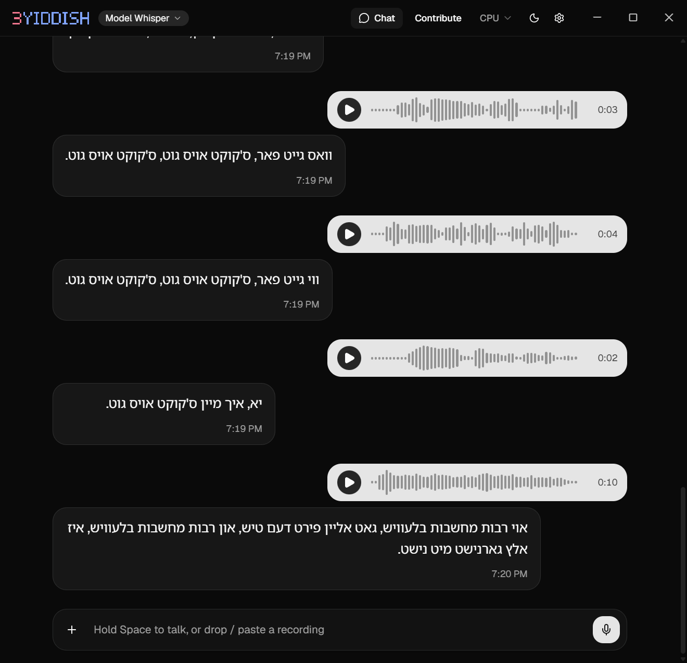
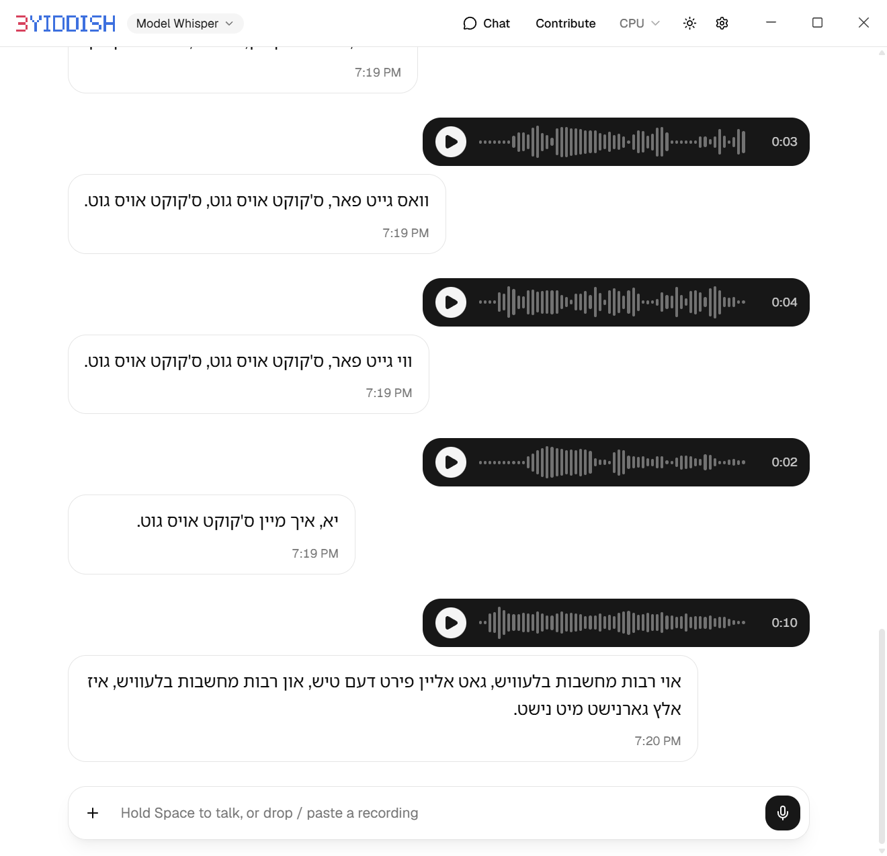
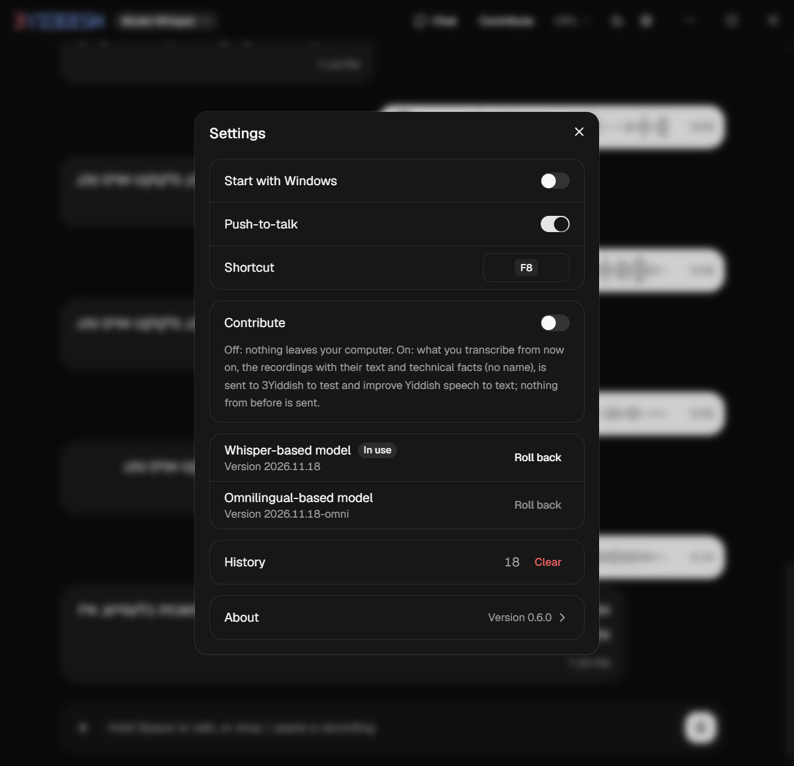
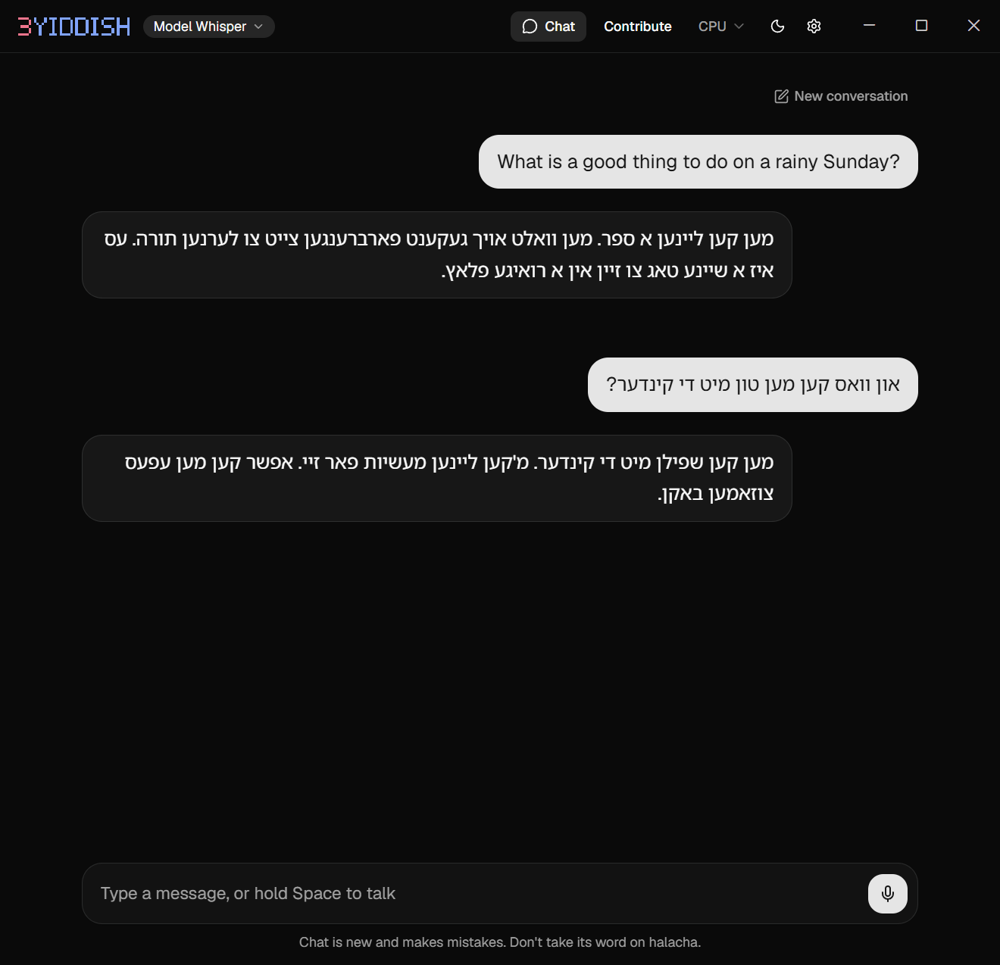
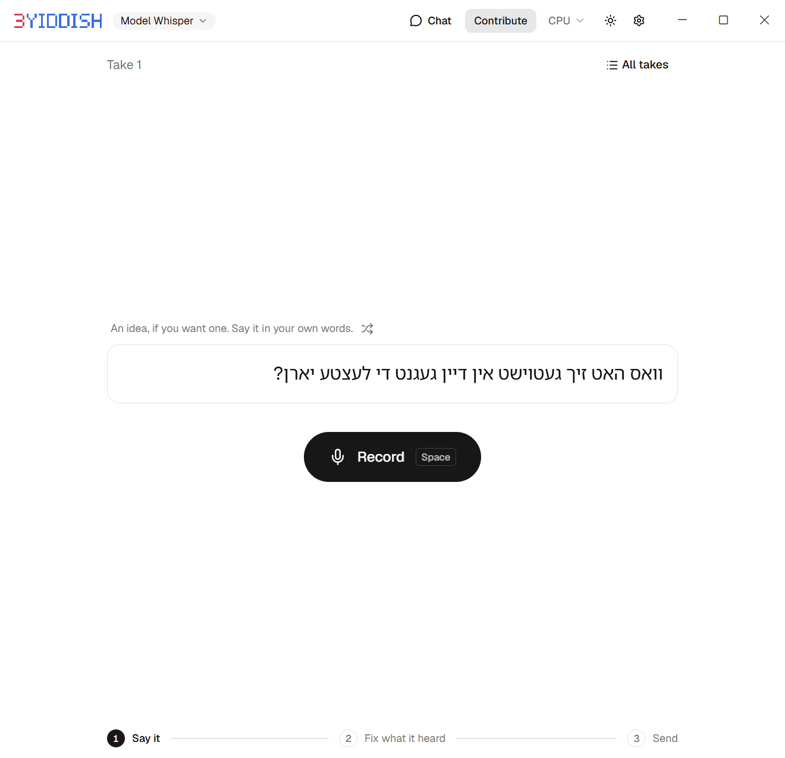

# 3Yiddish Desktop

**You talk Yiddish. It types Yiddish.** In a proper window, fully private on your own computer, for free, no account, no cloud, no nonsense.

This is the desktop app for [3Yiddish](https://github.com/TripleU613/3Yiddish), TripleU613's
Yiddish speech-to-text. Same speech models and engine, in a normal app with a mic button
instead of a terminal, and a fully implemented push-to-talk setup.

**[How good is it? See the benchmark.](BENCHMARK.md)**


## Get it

| Your computer | Download |
| --- | --- |
| **Windows** (10 or 11) | [3Yiddish-Desktop-windows-x64-setup.exe](https://github.com/MeilichM/3Yiddish/releases/latest/download/3Yiddish-Desktop-windows-x64-setup.exe) |
| **Mac** with Apple chip (M1 and newer) | [3Yiddish-Desktop-macos-apple-silicon.dmg](https://github.com/MeilichM/3Yiddish/releases/latest/download/3Yiddish-Desktop-macos-apple-silicon.dmg) |
| **Mac** with Intel chip | [3Yiddish-Desktop-macos-intel.dmg](https://github.com/MeilichM/3Yiddish/releases/latest/download/3Yiddish-Desktop-macos-intel.dmg) |
| **Linux** (any) | [3Yiddish-Desktop-linux-x64.AppImage](https://github.com/MeilichM/3Yiddish/releases/latest/download/3Yiddish-Desktop-linux-x64.AppImage) |
| **Linux** (Ubuntu, Debian, Mint) | [3Yiddish-Desktop-linux-x64.deb](https://github.com/MeilichM/3Yiddish/releases/latest/download/3Yiddish-Desktop-linux-x64.deb) |

Everything else (checksums, older versions) is on the [releases page](https://github.com/MeilichM/3Yiddish/releases).

The first time you open it, it asks whether to download the speech model (about 575 MB,
one time; go make a coffee) and shows the download as it goes.

<details>
<summary><b>Windows</b> says "Windows protected your PC"?</summary>

The app isn't signed with a paid certificate (yet), so Windows doesn't know it. Click
**More info**, then **Run anyway**.

The download uses your graphics card, which is about ten times faster. If the app doesn't
open at all after installing, your computer probably has no graphics driver. Install the
[processor-only version](https://github.com/MeilichM/3Yiddish/releases/latest/download/3Yiddish-Desktop-windows-x64-cpu-setup.exe)
instead.
</details>

<details>
<summary><b>Mac</b> says it "can't be opened" or "Apple could not verify" it?</summary>

Same story: no paid Apple certificate. Open the `.dmg`, drag **3Yiddish** into
**Applications**, and open it once. When the Mac refuses, go to **System Settings →
Privacy & Security**, scroll down, and click **Open Anyway** next to 3Yiddish. You only do
this once.

If it says the app "is damaged", it isn't. Open **Terminal** and paste:

```sh
xattr -dr com.apple.quarantine /Applications/3Yiddish.app
```

Macs always use the Apple graphics chip; nothing to pick.
</details>

<details>
<summary><b>Linux</b>: AppImage or .deb?</summary>

- **AppImage**: works on most distributions. Make it runnable and open it:
  `chmod +x 3Yiddish-Desktop-linux-x64.AppImage && ./3Yiddish-Desktop-linux-x64.AppImage`
- **.deb**: Ubuntu, Debian, Mint and friends. `sudo apt install ./3Yiddish-Desktop-linux-x64.deb`,
  then find 3Yiddish in your apps menu.

The Linux build runs on the processor.
</details>

## Use it

Click the mic, or hold **Space**, and say something. Let go. The Yiddish appears. Your recording stays above it as a voice note, so you can play yourself back.

Got a recording already? Click **+**, drag the file in, or paste it with Ctrl+V.

<p align="center"></p>

Light, dark, or whatever your computer uses: the sun/moon button at the top.

**Two models, one button.** Both are trained on heimish Yiddish: one built on OpenAI's
Whisper, one built on Meta's Omnilingual. They make different mistakes, so if one gets a
recording wrong, pick the other from the **Model** button at the top, or use **Transcribe
again with…** on that recording. The second one is downloaded only when you ask for it.
The **CPU/GPU** button shows whether your graphics card is doing the work; click it to switch.

### Type Yiddish anywhere (push-to-talk)

Hold **F9** in any program (email, WhatsApp, Word, a forum), speak, and let go: the Yiddish
is typed right where your cursor is. A little pill shows while it listens. Pick another key
or combination in **Settings** (the gear), or switch it off there. While push-to-talk is on,
closing the window keeps 3Yiddish in the tray (on a Mac, the menu bar) so the key keeps
working. **Start with Windows** / **Open at login** starts it there when you sign in.
Push-to-talk is made for Windows and Mac; on Linux it may not work on every desktop yet.

On a Mac, the first press asks for the microphone and for permission to type into other
apps. Say yes to both.



### Talk to it (Chat)

Click **Chat** at the top. The first time, it asks whether to download chat (about 6.4 GB,
once). Then talk or type, in Yiddish or English, and it answers in Yiddish. It runs on your
computer like everything else: a thinking model (Gemma, by Google) works out the answer, and
a translator trained on heimish Yiddish writes it the way people actually write. With a
graphics card an answer takes a few seconds; on the processor alone it can take a minute.
It's new and it makes mistakes, so don't take its word on halacha.



## Help it get better

Click **Contribute**. Say a few things in your own words (it suggests ideas if you're stuck),
fix the words the app got wrong, and press **Send**. No account; any name will do. Real
voices with real corrections are how the test gets honest and the models get better.

<p align="center"></p>

## Is my stuff private?

Yes. It all runs on your computer, and your voice stays there unless you say otherwise:

- **Contribute** in Settings is **off** unless you turn it on. Off means nothing leaves your
  computer.
- Turned on, it sends what you transcribe *from then on* (the recordings, their text and a
  few technical facts like versions, GPU or CPU, timings), never anything from before. No
  name and no computer id. They are kept privately and used to test, and maybe later to
  improve, Yiddish speech to text.
- **History** in Settings shows how many recordings the app keeps, and **Clear** deletes them.

If you never turn it on, the only thing it asks the internet is "got a newer model?"

## Prefer the terminal?

The original 3Yiddish is a terminal app (plus a local API, and it runs on Android in
Termux). It lives in [TripleU613's repository](https://github.com/TripleU613/3Yiddish),
with its own one-line installer. Both apps share their data folder, so a model downloaded by
one is used by the other.

## Build it yourself

See [desktop/README.md](desktop/README.md). The short version: Rust, Node.js 20+, CMake and
a C++ compiler, then `cd desktop && npm install && npm run tauri build`.

## About this repository

This is a fork of [TripleU613/3Yiddish](https://github.com/TripleU613/3Yiddish).

- **`main`**: the desktop app, built on top of 3Yiddish. Releases are tagged `desktop-vX.Y.Z`.
- **`upstream`**: TripleU613's `main`, commit for commit. Their updates are brought into
  `main` from there.

The speech models, the engine and almost everything that makes it understand Yiddish are
TripleU613's work. The desktop app is built on top.

## Rules (the short version)

[CC BY-NC-SA 4.0](LICENSE): use it, share it, change it, have fun.
**Don't sell it.** Ever. And anything you make from it stays just as free.
Credits for the giants whose shoulders we stand on: [NOTICE](NOTICE).

Want to hack on it? [CONTRIBUTING.md](CONTRIBUTING.md) has the grown-up instructions.
